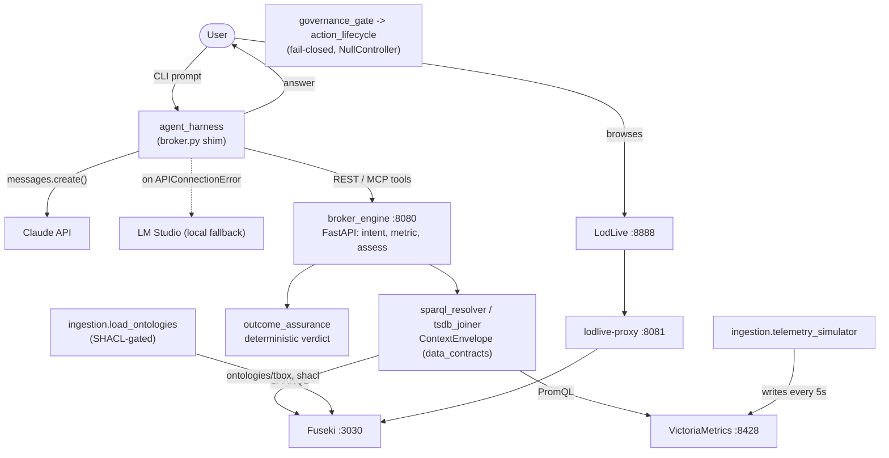

# Autonomous Context Broker

Compares live network telemetry (VictoriaMetrics) against declared intent
requirements (an OWL/RDFS graph in Apache Jena Fuseki), using Claude's
tool-calling loop (via the Anthropic SDK) to answer questions like
*"Is intent-core-health-01 compliant right now?"*

## Architecture

The repo is a layered Context Broker (spec: `docs/Context-Broker-Updated.md`)
grown from a single-file compliance agent by a strangler migration. The broker
engine serves bounded, quality-labelled context; it never decides or acts.



### Module map

| Package | Responsibility | Spec component |
|---|---|---|
| `data_contracts` | `ContextEnvelope` and state-quality labels shared by all layers | Data contracts |
| `broker_engine` | FastAPI app (`broker_engine.main:app`, REST + MCP), pruner, SPARQL/PromQL resolvers, `assess` | Context broker engine |
| `outcome_assurance` | Deterministic, three-valued intent verdict (the LLM is not the judge) | Outcome assurance |
| `agent_harness` | Tool-calling LLM loop (Claude, LM Studio fallback); `broker.py` is a thin CLI shim over it | Agent harness |
| `ontologies` | `tbox/` topology + intent ontology, `shacl/` shapes | Ontology / knowledge layer |
| `ingestion` | `load_ontologies` (SHACL-gated load into Fuseki), `telemetry_simulator`, `syslog_parser` | Ingestion |
| `intent_management` | Intent store | Intent management |
| `decision_records` | Record store | Decision records |
| `loop_coordination` | Reservation book to stop concurrent loops acting on the same target | Loop coordination |
| `artefact_governance` | Action catalogue and model registry | Artefact governance |
| `governance_gate` | Policy gate (action readiness) and controller interface; only `NullController` exists | Governance gate |
| `action_lifecycle` | Executor: proposal snapshot, gate check, recheck, fail-closed | Action lifecycle |
| `investigation_workers` | `model_client` protocol with threshold/router stubs; unapproved models rejected | Investigation workers |
| `state_reconciliation` | Event reconciler (stub) | State reconciliation |
| `source_federation`, `platform_services` | Placeholders | Not implemented |

### Data flow

1. `agent_harness` calls the broker engine over REST/MCP tools (`GET /context/intent/{id}`,
   `GET /context/metric`, `POST /context/assess`).
2. `broker_engine` resolves declared state from Fuseki and observed state from
   VictoriaMetrics, wraps each in a `ContextEnvelope` with quality metadata, and prunes it.
3. `outcome_assurance` computes the compliant / non-compliant / unknown verdict
   deterministically from the envelopes; the LLM only explains it.
4. Ontologies are loaded with `python -m ingestion.load_ontologies`, which
   validates every TBox file against every SHACL shape file first and posts
   nothing if any violation is found (empty directories are rejected).
5. Actions go through `governance_gate` and `action_lifecycle`. The gate is
   fail-closed and the only controller is `NullController`: no real network
   controller exists, so nothing is ever changed on a device.

### Not implemented

The spec lists these as candidates needing validation; none are built here:
Redpanda transport, Qdrant retrieval, OPA/Rego policy (the policy is Python),
Temporal durable execution, real LQM / System 1 / investigation models (only
stubs), and real controllers (Nornir, OpenDaylight). `state_reconciliation`
and the syslog parser are stubs, and the action catalogue is in-memory.

### `broker.py` and `agent_harness`

`broker.py` is a thin CLI shim; the loop lives in `agent_harness`
(`workflow.run_agent`, `tools.execute_tool`). Run `python broker.py "<question>"`
(or with no argument it prompts interactively). Tool arguments are validated
against strict allow-lists and the tools' own JSON schemas, which stops the LLM
from injecting query syntax or redirecting a query to another endpoint. If
Claude's API is unreachable (`anthropic.APIConnectionError`) the conversation
restarts against local LM Studio — see [Optional: local LM Studio
fallback](#optional-local-lm-studio-fallback).

### `ingestion/load_ontologies.py`

SHACL-gated loader. `load_ttl_to_fuseki(ttl_path, data_endpoint, auth)` `POST`s a
Turtle file to Fuseki's Graph Store endpoint (`/network-dataset/data`, basic auth
`admin`/`admin`, matching `ADMIN_PASSWORD` in `docker-compose.yml`).
`python -m ingestion.load_ontologies` (options `--tbox-dir`, `--shacl-dir`,
`--endpoint`) validates then loads `ontologies/tbox/*.ttl`. The legacy
`python seed_graph.py [ttl] [endpoint]` still works as a shim and loads a single
file without SHACL validation.

### `ingestion/telemetry_simulator.py`

Generates synthetic interface telemetry for `Router-A`/`GigabitEthernet0/0/0`
and `Router-B`/`GigabitEthernet0/0/1` (`in_octets`, `out_octets`, `input_drops`)
as InfluxDB line protocol under the `interface_metrics` measurement and writes it
to VictoriaMetrics (`/write`) every 5s. `input_drops` is `0` unless
`--inject-drops` is given (~5% chance of 1-20 per sample), which drives the
compliant-vs-non-compliant demo. `python -m ingestion.telemetry_simulator`
(continuous) or with `--once` for a single batch. `MEASUREMENT_NAME` is imported
by the broker engine so the metric name prefix cannot drift.

### `lodlive-proxy/jsonp_proxy.py`

A small stdlib-only HTTP proxy that sits in front of Fuseki so the
[LodLive](http://lodlive.it/) graph explorer can query it — see
[Optional: explore the graph visually](#optional-explore-the-graph-visually-lodlive).

- LodLive's SPARQL requests go through jQuery's `jquery.jsonp` plugin, which
  loads results via a `<script src="...">` tag and expects the response
  body to be JavaScript invoking a callback function — not raw JSON. Fuseki
  only ever returns plain `application/sparql-results+json`, so without
  this proxy the browser silently fails to execute the response.
- **`JsonpProxyHandler.do_GET`** reads the `query` parameter off the
  incoming request, forwards it to Fuseki's query endpoint, and wraps the
  JSON response as `<callback>(<json>);`. The callback name isn't fixed —
  `lodlive.core.js` calls `$.jsonp.setup({callback: 'lodlive'})` globally,
  so real requests carry an explicit `callback=lodlive` parameter, which
  the proxy honors; it falls back to `jquery.jsonp`'s own undeclared
  default (`_jqjsp`) only if a request omits the parameter. The callback
  name is validated against a JS-identifier allow-list before being
  embedded in the response, since it's executed as code.
- Runs as its own container (see `docker-compose.yml`); not meant to be run
  standalone outside Docker.

## Prerequisites

- Docker and Docker Compose
- Python 3.14 (the tested interpreter; the API image uses `python:3.14-slim`)
- An Anthropic API key (console.anthropic.com)

## 1. Set up the Python environment

A venv already exists at `venv/`. If you need to recreate it:

```bash
python3 -m venv venv
source venv/bin/activate
pip install -r requirements.txt
```

Dev/test-only dependencies (`pytest`, `pyyaml`, `rdflib`) are not in
`requirements.txt` — install them separately if you want to run the tests:

```bash
pip install pytest pyyaml rdflib
```

## 2. Configure the LLM

Edit `.env` and replace the placeholders with real values:

```
ANTHROPIC_API_KEY=your-api-key-here
MODEL_NAME=claude-opus-5
```

`MODEL_NAME` is optional — it defaults to `claude-opus-5` if unset.

### Optional: local LM Studio fallback

If Claude's API is unreachable (e.g. no network), `broker.py` falls back to a
local model served by [LM Studio](https://lmstudio.ai/). Add to `.env`:

```
LMSTUDIO_BASE_URL=http://<lm-studio-host>:1234/v1
LMSTUDIO_MODEL=<model-name-as-shown-in-lm-studio>
```

`LMSTUDIO_BASE_URL` defaults to `http://localhost:1234/v1` if unset.
`LMSTUDIO_MODEL` has no default — the fallback raises a clear error if it's
unset when Claude is unreachable, rather than guessing a model name.

If you're running this inside a VM (e.g. Ubuntu on VMware Fusion on a Mac)
and LM Studio runs on the host:
1. In LM Studio, enable **Serve on Local Network** (it only binds to
   `127.0.0.1` by default, which the VM can't reach).
2. Set the VM's network adapter to **Bridged** rather than NAT, so it shares
   the host's LAN and can reach the host's LAN IP directly.
3. Set `LMSTUDIO_BASE_URL` to `http://<mac-lan-ip>:1234/v1`.

The fallback only triggers on connection/network errors (timeout, DNS
failure, connection refused) — authentication and rate-limit errors from
Claude's API still fail loudly rather than being silently masked.

## 3. Start the data stores

```bash
docker compose up -d
```

This starts:
- **VictoriaMetrics** on `localhost:8428` (telemetry storage)
- **contextbroker-api** on `localhost:8080` (broker engine; OpenAPI docs at
  `/docs`; endpoints preset for the compose network, override with
  `FUSEKI_QUERY_ENDPOINT` / `VM_QUERY_ENDPOINT` — see `.env.example`)
- **Fuseki** on `localhost:3030`, dataset `network-dataset` (intent/topology graph).
  Both images are multi-arch (amd64/arm64), so this works on Apple Silicon and
  other ARM hosts without emulation. The Fuseki admin/query UI is browsable
  directly at `http://localhost:3030/`.

Fuseki's write endpoints (`/network-dataset/data`, `/network-dataset/update`)
require basic auth — username `admin`, password `admin` (set via
`ADMIN_PASSWORD` in `docker-compose.yml`). The query endpoint
(`/network-dataset/query`), used by the broker engine, is unauthenticated.

## 4. Seed the ontology into Fuseki

```bash
source venv/bin/activate
python -m ingestion.load_ontologies
```

Validates against `ontologies/shacl` and loads `ontologies/tbox/topology.ttl` — the `intent-core-health-01` requirement
(zero input drops) on the link between `Router-A`/`GigabitEthernet0/0/0`
and `Router-B`/`GigabitEthernet0/0/1`.

### Optional: explore the graph visually (LodLive)

`docker compose up -d` (step 3) also starts [LodLive](http://lodlive.it/), an
interactive click-to-expand RDF graph browser — similar in spirit to
Stardog's Explorer. Once the ontology is seeded, open:

```
http://localhost:8888/app_en.html
```

and click one of the pre-configured examples in the sidebar
(`intent-core-health-01`, the Router-A↔Router-B link, or the Router-A
interface) to start exploring. Clicking a node expands it to show its
connected neighbors.

Fuseki's SPARQL endpoint only returns plain JSON, but LodLive requires a
JSONP-wrapped response — `lodlive-proxy` (port 8081) sits between them to
translate, so LodLive is configured to query it rather than Fuseki
directly (see `lodlive/lodlive.profile.js` and
[`lodlive-proxy/jsonp_proxy.py`](#lodlive-proxyjsonp_proxypy)).

## 5. Start the telemetry simulator

Run once, to check it's working:

```bash
python -m ingestion.telemetry_simulator --once
```

Run continuously in the background (writes to VictoriaMetrics every 5s):

```bash
nohup python -m ingestion.telemetry_simulator > telemetry.log 2>&1 &
echo $! > telemetry.pid
```

Stop it later with `kill $(cat telemetry.pid)`.

By default the simulator emits zero `input_drops` (a compliant demo). Add
`--inject-drops` to randomly emit drops (~5% chance per sample) and see the
broker report a non-compliant result instead:

```bash
python -m ingestion.telemetry_simulator --inject-drops
```

## 6. Ask the broker

```bash
python broker.py "Is intent-core-health-01 compliant right now?"
```

The broker reads the intent's requirement from Fuseki, reads the observed
metric from VictoriaMetrics, and has the LLM compare the two and answer.

## Running the tests

Tests mock all network calls (Fuseki/VictoriaMetrics/LLM) except one, which
runs a real SPARQL query against `ontologies/tbox/topology.ttl` via `rdflib` — no
Docker required to run the suite:

```bash
pytest tests/ -v
```

## Shutting down

```bash
kill $(cat telemetry.pid)   # if running in the background
docker compose down
```
