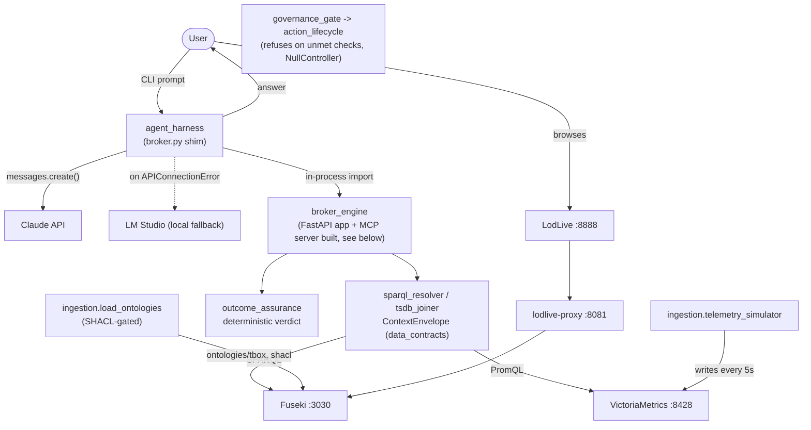

# Autonomous Context Broker

A context broker for intent-driven network operations. It answers one question
well: *"what is the state of this thing, how trustworthy is that answer, and does
it meet the declared intent?"*, for example *"Is intent-core-health-01 compliant
right now?"*

## What it is trying to achieve

The design principle (spec: `docs/Context-Broker-Updated.md`) is:

> AI proposes; the action-readiness check authorises; controllers execute; assurance verifies.

- **The broker resolves, joins, qualifies and delivers context. It never decides
  or acts.** It joins declared state (an OWL/RDFS graph in Apache Jena Fuseki) with
  observed state (telemetry in VictoriaMetrics) and wraps each result in a
  `ContextEnvelope` that carries quality labels (`stale`, `missing`, `conflicts`) and
  provenance.
- **The LLM is not the judge.** A deterministic assurance layer returns
  `success`, `failure` or `inconclusive`. Stale, missing, conflicted, drifted or
  unmappable evidence is never `success`. The LLM only explains the verdict.
- **Refuse unless proven safe.** Anything that could change a network goes through
  the action-readiness check (`governance_gate`) and the executor
  (`action_lifecycle`). The action-readiness check fails closed on the things it
  tests: if the evidence is stale, missing or conflicting, the template is not in the
  catalogue, the scope does not match, or the loop holds no reservation, the action is
  refused. It does not yet test identity, approval or validation readiness, so it
  cannot refuse for those.
- **Optionally verify against an external TMF921 intent server**
  ([BBF_921_java](https://github.com/bradspau/BBF_921_java)) so the broker's
  fresh evidence is judged by an independent intent engine.

It grew from a single-file compliance agent (`broker.py`) into the layered
structure below by a strangler migration.

## Current state

| Area | Status |
|---|---|
| Context envelope, resolvers (SPARQL and PromQL), pruning, freshness handling | Built, unit-tested |
| Deterministic outcome assurance (`success`/`failure`/`inconclusive`) | Built, unit-tested |
| REST API (`/context/intent/{id}`, `/context/metric`, `/context/assess`) | Built, unit-tested. Unauthenticated. |
| Agent harness (Claude tool-calling loop, LM Studio fallback, `broker.py` CLI) | Built, tested with mocks |
| MCP server | Built and unit-tested, **not mounted** or served by anything |
| Action-readiness check (`governance_gate`) and executor (`action_lifecycle`) | A library only. The check fails closed on evidence freshness, catalogue membership, scope and loop reservation; it does not test identity or approval. The only controller is `NullController`, so nothing is ever changed on a device. No runtime path submits a proposal. |
| TMF921 verification (`"source":"tmf921"`) | Built. Pushes fresh observations to the intent server, reads its reports, and maps them to a verdict. Opt-in. The default `graph` path is unchanged. |
| Intent / decision / loop / artefact stores | In-memory |
| LQM, System 1 / investigation models, state reconciliation, syslog parsing | Stubs |
| Redpanda, Qdrant, OPA/Rego, Temporal, Nornir, OpenDaylight | Not built (spec candidates only) |

The test suite has 488 tests (`pytest`). The work is on local `master` and has
not been pushed or reviewed upstream.

## Demo status

What has been run, and what has not.

**Verified live (containers, TMF921 path).** Against a running `tmf921-server`
container, with samples written into VictoriaMetrics:

| Scenario | Result |
|---|---|
| Fresh value above the bound | `success` |
| Fresh value below the bound | `failure` |
| Sample 10 minutes old | `inconclusive` ("stale observation"), nothing pushed |
| Two conflicting series | `inconclusive` ("conflicting observation"), nothing pushed |
| Re-assess after a `failure` | `inconclusive` ("intent bound drifted") |

**Not turnkey.**
- The telemetry simulator does not emit the five HSI metrics
  (`downstream_bandwidth_mbps`, `upstream_bandwidth_mbps`, `latency_ms`,
  `jitter_ms`, `packet_loss_percent`), so the TMF921 demo needs samples written to
  VictoriaMetrics directly.
- The first assess on a new series can read "missing" for a few seconds
  (VictoriaMetrics lag).
- The TMF921 server needs the licensed TM Forum ontology files, which are not in
  this repo. Mount them read-only from your own copy (see below).

**Not yet run.**
- The LLM agent (`broker.py`) end to end with a real API key. It is tested with
  mocks only.
- A live assess of a *complete* HSI intent (with `log:allOf` / `log:match` parts)
  on the server. The bound reader handles both demo `.ttl` files in unit tests
  only.

**Known limits of the demo.**
- After any Degraded evaluation the TMF921 server rewrites the intent's stored
  bound, so the intent must be re-created and re-pinned to assess again.
- Every `tmf921` assess writes observations to the intent server, and
  `POST /context/assess` has no authentication. Do not expose port 8080.
- Locks and high-water marks are in-process: run a single broker process.
- Observations pushed by other clients are invisible to the broker.

## Licensing

The TM Forum TIO ontology files and the TR290-292 / TMF921 PDFs are licensed.
They are git-ignored, never committed, never baked into an image, and only
bind-mounted read-only into `tmf921-server` at runtime.

## Architecture

The repo is a layered Context Broker (spec: `docs/Context-Broker-Updated.md`)
grown from a single-file compliance agent by a strangler migration. The broker
engine serves bounded, quality-labelled context; it never decides or acts.



### Module map

| Package | Responsibility | Spec component |
|---|---|---|
| `data_contracts` | `ContextEnvelope` and state-quality labels shared by all layers | Data contracts |
| `broker_engine` | FastAPI app (`broker_engine.main:app`, REST; MCP server built but not mounted), pruner, SPARQL/PromQL resolvers, `assess` | Context broker engine |
| `outcome_assurance` | Deterministic, three-valued intent verdict (the LLM is not the judge) | Outcome assurance |
| `agent_harness` | Tool-calling LLM loop (Claude, LM Studio fallback); `broker.py` is a thin CLI shim over it | Agent harness |
| `ontologies` | `tbox/` topology + intent ontology, `shacl/` shapes | Ontology / knowledge layer |
| `ingestion` | `load_ontologies` (SHACL-gated load into Fuseki), `telemetry_simulator`, `syslog_parser` | Ingestion |
| `intent_management` | Intent store | Intent management |
| `decision_records` | Record store | Decision records |
| `loop_coordination` | Reservation book to stop concurrent loops acting on the same target | Loop coordination |
| `artefact_governance` | Action catalogue and model registry | Artefact governance |
| `governance_gate` | Action-readiness check and controller interface; only `NullController` exists | Governance gate |
| `action_lifecycle` | Executor: proposal snapshot, readiness check, recheck; the executor fails closed | Action lifecycle |
| `investigation_workers` | `model_client` protocol with threshold/router stubs; unapproved models rejected | Investigation workers |
| `state_reconciliation` | Event reconciler (stub) | State reconciliation |
| `source_federation`, `platform_services` | Placeholders | Not implemented |

### Data flow

1. `agent_harness` imports `broker_engine` functions in-process (it does not call
   them over REST or MCP). Separately, `broker_engine.main:app` serves a REST API
   (`GET /context/intent/{id}`, `GET /context/metric`, `POST /context/assess`) via
   `uvicorn broker_engine.main:app`. `POST /context/assess` also accepts
   `"source":"tmf921"` (default `"graph"`) to assess via the TMF921 intent server.
   An MCP server is built and unit-tested (`broker_engine.main.build_mcp_server()`)
   but is NOT mounted on that app and nothing serves it; to use it you would have
   to run it yourself, e.g. `build_mcp_server().run()`.
2. `broker_engine` resolves declared state from Fuseki and observed state from
   VictoriaMetrics, wraps each in a `ContextEnvelope` with quality metadata, and prunes it.
3. `outcome_assurance` computes the success / failure / inconclusive verdict
   deterministically from the envelopes; the LLM only explains it.
4. Ontologies are loaded with `python -m ingestion.load_ontologies`, which
   validates every TBox file against every SHACL shape file first and posts
   nothing if any violation is found (empty directories are rejected).
5. `governance_gate` and `action_lifecycle` are a library only: no runtime path builds
   or submits an `ActionProposal`. The action-readiness check fails closed on the things it tests, and the only controller is
   `NullController`, so nothing is ever changed on a device. The executor's "recheck"
   re-ages the evidence and re-checks the reservation and catalogue; it does NOT re-read
   current network state, and `ActionTemplate.preconditions` are not evaluated. The
   check also does not implement identity, approval or validation-readiness checks from
   the spec.
6. The freshness check fails closed: a telemetry value whose last-sample time cannot be
   established (timestamp query fails, is empty or unparseable) is marked
   `quality.stale`, and across several matching series the oldest sample is judged.
7. `stateCategory`, `validFrom` and `validTo` are declared in the TBox/SHACL but are
   not yet read or enforced by the broker.

### Not implemented

The spec lists these as candidates needing validation; none are built here:
Redpanda transport, Qdrant retrieval, OPA/Rego policy (the policy is Python),
Temporal durable execution, real LQM / System 1 / investigation models (only
stubs), and real controllers (Nornir, OpenDaylight). `state_reconciliation`
and the syslog parser are stubs, and the action catalogue is in-memory.

### `broker.py` and `agent_harness`

`broker.py` is a thin CLI shim; the loop lives in `agent_harness`
(`workflow.run_agent`, `tools.execute_tool`). Run `python broker.py "<question>"`
(or with no argument it prompts interactively). Tool arguments are validated
against strict allow-lists and the tools' own JSON schemas, which stops the LLM
from injecting query syntax or redirecting a query to another endpoint. If
Claude's API is unreachable (`anthropic.APIConnectionError`) the conversation
restarts against local LM Studio — see [Optional: local LM Studio
fallback](#optional-local-lm-studio-fallback).

### `ingestion/load_ontologies.py`

SHACL-gated loader. `load_ttl_to_fuseki(ttl_path, data_endpoint, auth)` `POST`s a
Turtle file to Fuseki's Graph Store endpoint (`/network-dataset/data`, basic auth
`admin`/`admin`, matching `ADMIN_PASSWORD` in `docker-compose.yml`).
`python -m ingestion.load_ontologies` (options `--tbox-dir`, `--shacl-dir`,
`--endpoint`) validates then loads `ontologies/tbox/*.ttl`. The legacy
`python seed_graph.py [ttl] [endpoint]` still works as a shim and loads a single
file without SHACL validation.

### `ingestion/telemetry_simulator.py`

Generates synthetic interface telemetry for `Router-A`/`GigabitEthernet0/0/0`
and `Router-B`/`GigabitEthernet0/0/1` (`in_octets`, `out_octets`, `input_drops`)
as InfluxDB line protocol under the `interface_metrics` measurement and writes it
to VictoriaMetrics (`/write`) every 5s. `input_drops` is `0` unless
`--inject-drops` is given (~5% chance of 1-20 per sample), which drives the
compliant-vs-non-compliant demo. `python -m ingestion.telemetry_simulator`
(continuous) or with `--once` for a single batch. `MEASUREMENT_NAME` is imported
by the broker engine so the metric name prefix cannot drift.

### `lodlive-proxy/jsonp_proxy.py`

A small stdlib-only HTTP proxy that sits in front of Fuseki so the
[LodLive](http://lodlive.it/) graph explorer can query it — see
[Optional: explore the graph visually](#optional-explore-the-graph-visually-lodlive).

- LodLive's SPARQL requests go through jQuery's `jquery.jsonp` plugin, which
  loads results via a `<script src="...">` tag and expects the response
  body to be JavaScript invoking a callback function — not raw JSON. Fuseki
  only ever returns plain `application/sparql-results+json`, so without
  this proxy the browser silently fails to execute the response.
- **`JsonpProxyHandler.do_GET`** reads the `query` parameter off the
  incoming request, forwards it to Fuseki's query endpoint, and wraps the
  JSON response as `<callback>(<json>);`. The callback name isn't fixed —
  `lodlive.core.js` calls `$.jsonp.setup({callback: 'lodlive'})` globally,
  so real requests carry an explicit `callback=lodlive` parameter, which
  the proxy honors; it falls back to `jquery.jsonp`'s own undeclared
  default (`_jqjsp`) only if a request omits the parameter. The callback
  name is validated against a JS-identifier allow-list before being
  embedded in the response, since it's executed as code.
- Runs as its own container (see `docker-compose.yml`); not meant to be run
  standalone outside Docker.

## Prerequisites

- Docker and Docker Compose
- Python 3.14 (the tested interpreter; the API image uses `python:3.14-slim`)
- An Anthropic API key (console.anthropic.com)

## 1. Set up the Python environment

A venv already exists at `venv/`. If you need to recreate it:

```bash
python3 -m venv venv
source venv/bin/activate
pip install -r requirements.txt
```

`rdflib` is pinned in `requirements.txt`. Dev/test-only dependencies
(`pytest`, `pyyaml`) are not; install them separately to run the tests:

```bash
pip install pytest pyyaml
```

## 2. Configure the LLM

Edit `.env` and replace the placeholders with real values:

```
ANTHROPIC_API_KEY=your-api-key-here
MODEL_NAME=claude-opus-5
```

`MODEL_NAME` is optional — it defaults to `claude-opus-5` if unset.

### Optional: local LM Studio fallback

If Claude's API is unreachable (e.g. no network), `broker.py` falls back to a
local model served by [LM Studio](https://lmstudio.ai/). Add to `.env`:

```
LMSTUDIO_BASE_URL=http://<lm-studio-host>:1234/v1
LMSTUDIO_MODEL=<model-name-as-shown-in-lm-studio>
```

To use LM Studio **instead of** Claude (Claude is then never contacted, and no
Anthropic key is needed), also set:

```
LLM_BACKEND=lmstudio
```

`LLM_BACKEND` is `claude` (default; Claude with the LM Studio fallback below) or
`lmstudio`. Any other value raises an error. With `lmstudio`, `LMSTUDIO_MODEL` is
required. The model must support OpenAI-style tool calling.

`LMSTUDIO_BASE_URL` defaults to `http://localhost:1234/v1` if unset.
`LMSTUDIO_MODEL` has no default — the fallback raises a clear error if it's
unset when Claude is unreachable, rather than guessing a model name.

If you're running this inside a VM (e.g. Ubuntu on VMware Fusion on a Mac)
and LM Studio runs on the host:
1. In LM Studio, enable **Serve on Local Network** (it only binds to
   `127.0.0.1` by default, which the VM can't reach).
2. Set the VM's network adapter to **Bridged** rather than NAT, so it shares
   the host's LAN and can reach the host's LAN IP directly.
3. Set `LMSTUDIO_BASE_URL` to `http://<mac-lan-ip>:1234/v1`.

The fallback only triggers on connection/network errors (timeout, DNS
failure, connection refused) — authentication and rate-limit errors from
Claude's API still fail loudly rather than being silently masked.

## 3. Start the data stores

```bash
docker compose up -d
```

This starts:
- **VictoriaMetrics** on `localhost:8428` (telemetry storage)
- **contextbroker-api** on `localhost:8080` (broker engine; OpenAPI docs at
  `/docs`; endpoints preset for the compose network, override with
  `FUSEKI_QUERY_ENDPOINT` / `VM_QUERY_ENDPOINT` — see `.env.example`)
- **Fuseki** on `localhost:3030`, dataset `network-dataset` (intent/topology graph).
  Both images are multi-arch (amd64/arm64), so this works on Apple Silicon and
  other ARM hosts without emulation. The Fuseki admin/query UI is browsable
  directly at `http://localhost:3030/`.

Fuseki's write endpoints (`/network-dataset/data`, `/network-dataset/update`)
require basic auth — username `admin`, password `admin` (set via
`ADMIN_PASSWORD` in `docker-compose.yml`). The query endpoint
(`/network-dataset/query`), used by the broker engine, is unauthenticated.

## 4. Seed the ontology into Fuseki

```bash
source venv/bin/activate
python -m ingestion.load_ontologies
```

Validates against `ontologies/shacl` and loads `ontologies/tbox/topology.ttl` — the `intent-core-health-01` requirement
(zero input drops) on the link between `Router-A`/`GigabitEthernet0/0/0`
and `Router-B`/`GigabitEthernet0/0/1`.

### Optional: explore the graph visually (LodLive)

`docker compose up -d` (step 3) also starts [LodLive](http://lodlive.it/), an
interactive click-to-expand RDF graph browser — similar in spirit to
Stardog's Explorer. Once the ontology is seeded, open:

```
http://localhost:8888/app_en.html
```

and click one of the pre-configured examples in the sidebar
(`intent-core-health-01`, the Router-A↔Router-B link, or the Router-A
interface) to start exploring. Clicking a node expands it to show its
connected neighbors.

Fuseki's SPARQL endpoint only returns plain JSON, but LodLive requires a
JSONP-wrapped response — `lodlive-proxy` (port 8081) sits between them to
translate, so LodLive is configured to query it rather than Fuseki
directly (see `lodlive/lodlive.profile.js` and
[`lodlive-proxy/jsonp_proxy.py`](#lodlive-proxyjsonp_proxypy)).

## 5. Start the telemetry simulator

Run once, to check it's working:

```bash
python -m ingestion.telemetry_simulator --once
```

Run continuously in the background (writes to VictoriaMetrics every 5s):

```bash
nohup python -m ingestion.telemetry_simulator > telemetry.log 2>&1 &
echo $! > telemetry.pid
```

Stop it later with `kill $(cat telemetry.pid)`.

By default the simulator emits zero `input_drops` (a compliant demo). Add
`--inject-drops` to randomly emit drops (~5% chance per sample) and see the
broker report a non-compliant result instead:

```bash
python -m ingestion.telemetry_simulator --inject-drops
```

## 6. Ask the broker

```bash
python broker.py "Is intent-core-health-01 compliant right now?"
```

The broker reads the intent's requirement from Fuseki, reads the observed
metric from VictoriaMetrics, and deterministically computes the verdict
(success / failure / inconclusive); the LLM only explains that verdict.

## Using an external TMF921 intent server

The broker can take the intent (and its handling state) from a TMF921 server
(BBF_921_java) instead of the ontology graph. The server runs as an opt-in
compose service (profile `tmf921`); the licensed TM Forum TIO ontology files stay
on the host and are only bind-mounted read-only (never committed, never baked
into an image).

1. Check the host ontology directory (`TIO_ONTOLOGY_DIR`, see `.env.example`):
   `bash scripts/tmf921_preflight.sh`
2. Start the server (and the broker): `docker compose --profile tmf921 up -d --build`
   (port 8000, bound to 127.0.0.1).
3. Create an intent the way `seed_data/seed.sh` in BBF_921_java does, against
   `localhost:8000`. The bound must carry `quan:unit "Mbps"` (inside the bracketed
   quantity, e.g. `[ rdf:value "100"^^xsd:decimal ; quan:unit "Mbps" ]`), otherwise the
   server reports a unit mismatch. Pattern (placeholders in angle brackets):
   `curl -sf -X POST "$BASE/intent" -H "Content-Type: application/json" -d '{"@type":"Intent","name":"<name>","expression":{"@type":"TurtleExpression","expressionValue":"<turtle>"}}'`
   then activate it:
   `curl -sf -X PATCH "$BASE/intent/<intent_id>" -H "Content-Type: application/json" -d '{"lifecycleStatus": "ACTIVE"}'`
   with `BASE=http://localhost:8000/tmf-api/intentManagement/v5`.
4. Pin the bound in the bindings file (default `data_contracts/intent_bindings.json`,
   ships as `{}`; mount your own with `HOST_INTENT_BINDINGS`, read-only):
   `{"<intent_id>": {"http://broadband-forum.org/Intent#DownstreamBandwidthMetric":
   {"device": "olt1", "interface": "pon0", "bound": 100}}}`.
   The metric map (`data_contracts/metric_map.json`, `METRIC_MAP_PATH`) maps the five
   HSI metrics to broker metric names such as `downstream_bandwidth_mbps`.
5. Assess:
   `curl -X POST localhost:8080/context/assess -H 'Content-Type: application/json' -d '{"intent_id":"<id>","time_window":"30m","source":"tmf921"}'`

The value judged on the TMF921 path is the latest sample in the window
(`last_over_time`), not the window maximum, so an old high value cannot satisfy
an `atLeast` bound; the graph path keeps `max_over_time`.

Safety behaviour: stale, missing, conflicted, drifted or unpushable evidence gives
`inconclusive`, never `success`. A partial-evidence assess pushes nothing to the
server. The server's Flow 3 rewrites an intent's stored bound after any Degraded
evaluation, so after a `failure` the same intent reports "intent bound drifted"
(`inconclusive`) until it is re-created and re-pinned; this is server-side behaviour
to raise with its owner. Per-intent locks and high-water marks are in-process, so
run a single broker process. Observations pushed by other clients are invisible to the broker.

Known behaviours / troubleshooting:
- The first assess right after a new series appears can return `inconclusive`
  "missing observation": VictoriaMetrics does not expose very recent samples
  immediately (observed live, about 2-15 s). Retry; the TMF921 assess fails closed (returns `inconclusive`) in the meantime.
- If `HOST_INTENT_BINDINGS` points at a file that does not exist before
  `docker compose up`, Docker creates a DIRECTORY there and every tmf921 assess
  returns 200 `inconclusive` "invalid binding" with no detail. Create the file first
  (`cp data_contracts/intent_bindings.json <path>`). A malformed bindings file gives
  the same result.
- The TMF921 server writes two Degraded reports for a new intent (creation and
  activation) before any observation, so a freshly activated intent shows 2 reports
  and a Degraded state until an observation arrives.

Not done / limitations: polling only (no hub/webhook subscription); one source per
metric URI; access-profile resources (UNI/PON, port 8001) are not mapped; the
`compare` and `jena` evaluator engines were only spot-checked; the TIO files are
mounted from the host and are not part of any image or commit.

## Running the tests

Tests mock all network calls (Fuseki/VictoriaMetrics/LLM) except one, which
runs a real SPARQL query against `ontologies/tbox/topology.ttl` via `rdflib` — no
Docker required to run the suite:

```bash
pytest tests/ -v
```

## Shutting down

```bash
kill $(cat telemetry.pid)   # if running in the background
docker compose down
```
