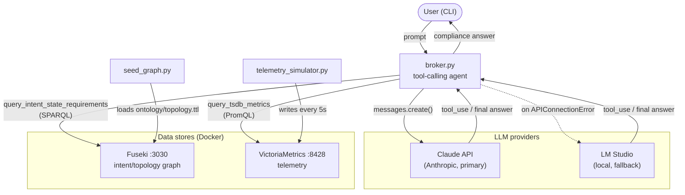

# Autonomous Context Broker

Compares live network telemetry (VictoriaMetrics) against declared intent
requirements (an OWL/RDFS graph in Apache Jena Fuseki), using Claude's
tool-calling loop (via the Anthropic SDK) to answer questions like
*"Is intent-core-health-01 compliant right now?"*

## Architecture



`broker.py` is the only component that talks to an LLM. It calls two tools —
`query_intent_state_requirements` (Fuseki) and `query_tsdb_metrics`
(VictoriaMetrics) — and hands their results to Claude to compare and answer.
`seed_graph.py` and `telemetry_simulator.py` are one-off/background setup
scripts that populate the two data stores; they never touch the LLM.

## Prerequisites

- Docker and Docker Compose
- Python 3.11
- An Anthropic API key (console.anthropic.com)

## 1. Set up the Python environment

A venv already exists at `venv/`. If you need to recreate it:

```bash
python3 -m venv venv
source venv/bin/activate
pip install -r requirements.txt
```

Dev/test-only dependencies (`pytest`, `pyyaml`, `rdflib`) are not in
`requirements.txt` — install them separately if you want to run the tests:

```bash
pip install pytest pyyaml rdflib
```

## 2. Configure the LLM

Edit `.env` and replace the placeholders with real values:

```
ANTHROPIC_API_KEY=your-api-key-here
MODEL_NAME=claude-opus-5
```

`MODEL_NAME` is optional — it defaults to `claude-opus-5` if unset.

### Optional: local LM Studio fallback

If Claude's API is unreachable (e.g. no network), `broker.py` falls back to a
local model served by [LM Studio](https://lmstudio.ai/). Add to `.env`:

```
LMSTUDIO_BASE_URL=http://<lm-studio-host>:1234/v1
LMSTUDIO_MODEL=<model-name-as-shown-in-lm-studio>
```

`LMSTUDIO_BASE_URL` defaults to `http://localhost:1234/v1` if unset.
`LMSTUDIO_MODEL` has no default — the fallback raises a clear error if it's
unset when Claude is unreachable, rather than guessing a model name.

If you're running this inside a VM (e.g. Ubuntu on VMware Fusion on a Mac)
and LM Studio runs on the host:
1. In LM Studio, enable **Serve on Local Network** (it only binds to
   `127.0.0.1` by default, which the VM can't reach).
2. Set the VM's network adapter to **Bridged** rather than NAT, so it shares
   the host's LAN and can reach the host's LAN IP directly.
3. Set `LMSTUDIO_BASE_URL` to `http://<mac-lan-ip>:1234/v1`.

The fallback only triggers on connection/network errors (timeout, DNS
failure, connection refused) — authentication and rate-limit errors from
Claude's API still fail loudly rather than being silently masked.

## 3. Start the data stores

```bash
docker compose up -d
```

This starts:
- **VictoriaMetrics** on `localhost:8428` (telemetry storage)
- **Fuseki** on `localhost:3030`, dataset `network-dataset` (intent/topology graph).
  Both images are multi-arch (amd64/arm64), so this works on Apple Silicon and
  other ARM hosts without emulation. The Fuseki admin/query UI is browsable
  directly at `http://localhost:3030/`.

Fuseki's write endpoints (`/network-dataset/data`, `/network-dataset/update`)
require basic auth — username `admin`, password `admin` (set via
`ADMIN_PASSWORD` in `docker-compose.yml`). The query endpoint
(`/network-dataset/query`), used by `broker.py`, is unauthenticated.

## 4. Seed the ontology into Fuseki

```bash
source venv/bin/activate
python seed_graph.py
```

Loads `ontology/topology.ttl` — the `intent-core-health-01` requirement
(zero input drops) on the link between `Router-A`/`GigabitEthernet0/0/0`
and `Router-B`/`GigabitEthernet0/0/1`.

## 5. Start the telemetry simulator

Run once, to check it's working:

```bash
python telemetry_simulator.py --once
```

Run continuously in the background (writes to VictoriaMetrics every 5s):

```bash
nohup python telemetry_simulator.py > telemetry.log 2>&1 &
echo $! > telemetry.pid
```

Stop it later with `kill $(cat telemetry.pid)`.

By default the simulator emits zero `input_drops` (a compliant demo). Add
`--inject-drops` to randomly emit drops (~5% chance per sample) and see the
broker report a non-compliant result instead:

```bash
python telemetry_simulator.py --inject-drops
```

## 6. Ask the broker

```bash
python broker.py "Is intent-core-health-01 compliant right now?"
```

The broker reads the intent's requirement from Fuseki, reads the observed
metric from VictoriaMetrics, and has the LLM compare the two and answer.

## Running the tests

Tests mock all network calls (Fuseki/VictoriaMetrics/LLM) except one, which
runs a real SPARQL query against `ontology/topology.ttl` via `rdflib` — no
Docker required to run the suite:

```bash
pytest tests/ -v
```

## Shutting down

```bash
kill $(cat telemetry.pid)   # if running in the background
docker compose down
```
