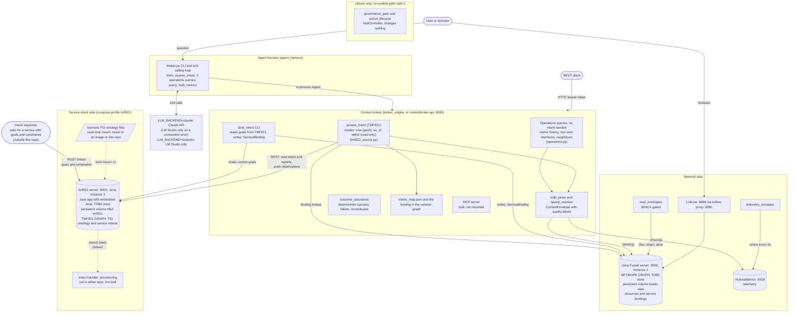

# Autonomous Context Broker

A context broker for intent-driven network operations. It answers one question
well: *"what is the state of this thing, how trustworthy is that answer, and does
it meet the declared intent?"*, for example *"Is intent `<intent_id>` compliant
right now?"*

## What it is trying to achieve

The design principle (spec: `docs/Architecture/AI_Ready_Network_Operations_Integrated_Architecture_with_OKF.md`) is:

> AI proposes; the action-readiness check authorises; controllers execute; assurance verifies.

- **The broker resolves, joins, qualifies and delivers context. It never decides
  or acts.** It joins declared state (an OWL/RDFS graph in Apache Jena Fuseki) with
  observed state (telemetry in VictoriaMetrics) and wraps each result in a
  `ContextEnvelope` that carries quality labels (`stale`, `missing`, `conflicts`) and
  provenance.
- **The LLM is not the judge.** A deterministic assurance layer returns
  `success`, `failure` or `inconclusive`. Stale, missing, conflicted, changed-goal or
  unmappable evidence is never `success`. The LLM only explains the verdict.
- **Refuse unless proven safe.** Anything that could change a network goes through
  the action-readiness check (`governance_gate`) and the executor
  (`action_lifecycle`). The action-readiness check fails closed on the things it
  tests: if the evidence is stale, missing or conflicting, the template is not in the
  catalogue, the scope does not match, or the loop holds no reservation, the action is
  refused. It does not yet test identity, approval or validation readiness, so it
  cannot refuse for those.
- **Verify against an external TMF921 intent server** (the default source;
  [BBF_921_java](https://github.com/bradspau/BBF_921_java)) so the broker's
  fresh evidence is judged by an independent intent engine.

It grew from a single-file compliance agent (`broker.py`) into the layered
structure below by a strangler migration.

## Current state

| Area | Status |
|---|---|
| Context envelope, resolvers (SPARQL and PromQL), pruning, freshness handling | Built, unit-tested |
| Deterministic outcome assurance (`success`/`failure`/`inconclusive`) | Built, unit-tested |
| REST API (`/context/metric`, `/context/assess` and the three operations queries) | Built, unit-tested. Every `/context/*` route needs a bearer token with a scope (see [Authentication](#authentication)); `GET /health` is public. |
| Operations queries, no intent needed (`metric-history`, `interfaces-nonzero`, `neighbours`; REST, MCP and agent tools) | Built, unit-tested, run live against Fuseki, VictoriaMetrics and LM Studio |
| Agent harness (Claude tool-calling loop, LM Studio fallback, `broker.py` CLI) | Built, tested with mocks |
| MCP server | Built and unit-tested, **not mounted** or served by anything |
| Action-readiness check (`governance_gate`) and executor (`action_lifecycle`) | A library only. The check fails closed on evidence freshness, catalogue membership, scope and loop reservation; it does not test identity or approval. The only controller is `NullController`, so nothing is ever changed on a device. No runtime path submits a proposal. |
| TMF921 verification (`"source":"tmf921"`, the only source) | Built. Pushes fresh observations to the intent server, reads its reports, and maps them to a verdict. The old graph intent path was removed (see [Removed: the old graph intent path](#removed-the-old-graph-intent-path)). |
| Intent / decision / loop / artefact stores | In-memory |
| LQM, System 1 / investigation models, state reconciliation, syslog parsing | Stubs |
| Redpanda, Qdrant, OPA/Rego, Temporal, Nornir, OpenDaylight | Not built (spec candidates only) |

The test suite has 928 tests passing plus 15 live TMF921 tests that are skipped
unless `TMF921_LIVE=1` (`pytest`). The work is on the `fullnetwork` branch
(pushed to GitHub) and has not been reviewed by anyone else.

## Demo status

What has been run, and what has not.

**Verified live (containers, TMF921 path).** Against a running `tmf921-server`
container, with samples written into VictoriaMetrics:

| Scenario | Result |
|---|---|
| Fresh value above the limit | `success` |
| Fresh value below the limit | `failure` |
| Sample 10 minutes old | `inconclusive` ("stale observation"), nothing pushed |
| Two conflicting series | `inconclusive` ("conflicting observation"), nothing pushed |
| Re-assess after a `failure` | `inconclusive` ("goal changed: LatencyMetric pinned 25, now 40.535") |

**HSI demo end to end on TMF921 alone (verified live 2026-10-28).** The complete
public HSI demo intent (BBF_921_java `seed_data/hsi_demo_intent.ttl`, with its
`log:allOf` / `log:match` parts and five quantity conditions), the simulator as
the only telemetry source, all five metrics bound to `Router-A/GigabitEthernet0/0/0`:

```bash
# Fuseki, VictoriaMetrics and tmf921-server running; ontology loaded once
python -m ingestion.load_ontologies
bash scripts/create_demo_intent.sh <BBF_921_java>/seed_data/hsi_demo_intent.ttl "HSI demo"
P=Router-A/GigabitEthernet0/0/0
python -m ingestion.bind_intent <intent_id> --place LatencyMetric=$P --place JitterMetric=$P \
  --place PacketLossMetric=$P --place DownstreamBandwidthMetric=$P --place UpstreamBandwidthMetric=$P
python -m ingestion.telemetry_simulator --hsi          # or --hsi-breach for latency 40-60 ms
# wait ~20 s for VictoriaMetrics, then assess (tmf921 is the default source);
# past questions add as_of ("10m") and mode ("at" or "within")
```

| Step | Result |
|---|---|
| Compliant samples, current assess | `success` |
| `--hsi-breach` (latency 40.5 ms vs 25 ms), current assess | `failure`, reason "goal not met" (names no metric, see limits) |
| Re-assess the same intent after that `failure` | `inconclusive` ("goal changed: LatencyMetric pinned 25, now 40.535"): the server's stored latency goal differs from the pin |
| New intent (new id) and new binding, compliant samples | `success` |
| `mode=within`, 5 m window containing the breach | `failure`, "LatencyMetric: ... observed 59.22 does not satisfy < 25.0" |
| `as_of=10m`, `mode=at`, instant in the compliant period | `success` |
| `as_of=10m`, `mode=at`, instant in the breach period | `failure`, LatencyMetric observed 47.994 |
| `as_of=10m`, `mode=within`, window containing the breach | `failure`, LatencyMetric observed 58.848 |
| Restart `fuseki` and `tmf921-server`, no reload | binding (five pinned goals) and intent (`ACTIVE`, goals intact) still there; fresh assess `success` |

**Not turnkey.**
- The first assess on a new series can read "missing" for a few seconds
  (VictoriaMetrics lag); wait about 20 s after starting the simulator.
- The TMF921 server needs the licensed TM Forum ontology files, which are not in
  this repo. Mount them read-only from your own copy (see below).

**Not yet run.**
- The LLM agent (`broker.py`) end to end with a real API key. It is tested with
  mocks only.

**Known limits of the demo.**
- After any Degraded evaluation the TMF921 server replaces the failed goal in the
  intent with the value it observed (its best-effort proposal, by design). It does
  not mark the change and keeps no copy of the original, so the goal recorded when
  the intent was bound is the only record of what was asked for. The broker reports
  the difference as `inconclusive` and does not judge the cause. To assess again
  the intent must be re-created (new id) and bound again; `bind_intent --replace`
  on the same intent pins the changed goal.
- A current-moment `tmf921` `failure` says only "goal not met": the server's
  JSON reason (`40.535 ms < 25 ms: FAIL`) names no metric. The failing condition
  is only in its TR290 report (`icm:about bbf:Lat_Check`). The past-question
  assess names the metric because the broker judges it.
- The operator for past-window verdicts comes from metric_map.json, verified live
  against the server on 2026-10-28; another intent could use a different comparison
  for the same metric.
- Every current-moment `tmf921` assess (no `as_of`, no `mode`) writes observations
  to the intent server. This is the default, so a request with no `source` does it
  too. `POST /context/assess` therefore needs the `context:assess` scope, and port
  8080 is still published on all interfaces: keep it behind your own network controls
  as well as the bearer token.
- Locks and high-water marks are in-process: run a single broker process.
- Observations pushed by other clients are invisible to the broker.

## Licensing

The TM Forum TIO ontology files and the TR290-292 / TMF921 PDFs are licensed.
They are git-ignored, never committed, never baked into an image, and only
bind-mounted read-only into `tmf921-server` at runtime.

## Architecture

The repo is a layered Context Broker (spec: `docs/Architecture/AI_Ready_Network_Operations_Integrated_Architecture_with_OKF.md`)
grown from a single-file compliance agent by a strangler migration. The broker
engine serves bounded, quality-labelled context; it never decides or acts.



The broker is an observer of TMF921 intents, not the front door. A requester creates
an intent with `POST /intent` on the TMF921 server, which stores it in its graph. The
server evaluates it against observations and writes reports. Provisioning the service
is the job of an intent handler that is in neither this repo nor `BBF_921_java`. The
broker only reads intents and reports and pushes observations (`Tmf921Client` has no
create call), so it never creates, changes or deletes an intent.

### Two separate graphs

The solution has two graphs that are **not** merged, queried together or kept in sync:

| | Network graph | TMF921 graph |
|---|---|---|
| Jena instance | Instance 1: a standalone Fuseki server (`fuseki` container, port 3030) | Instance 2: Jena embedded in the `tmf921-server` Java app (its own container, REST on 127.0.0.1:8000) |
| Dataset | `network-dataset` | a TDB2 store at `/app/tdb2-data` |
| Persistence | Docker volume `fuseki-data` (TDB2), survives restarts | Docker volume `tdb2-tmf921`, survives restarts |
| Ontology | our own small one in `ontologies/tbox/topology.ttl` | the licensed TM Forum TIO ontology (never in this repo) |
| Holds | resources and service bindings (devices, interfaces, topology links) | service intents (e.g. HSI bandwidth and latency) and their reports |
| Broker access | direct SPARQL | REST only |
| Used by | the neighbours query and the bindings | `source: "tmf921"` (the only source) |

Intents live only in the TMF921 graph. The network graph holds the devices, interfaces and
topology links, and is connected to an intent by a binding. A
binding lives in the network graph as a `:ServiceBinding` resource (written with
`python -m ingestion.bind_intent`) that maps a TMF921 intent and metric URI to a device,
an interface and a pinned goal. There is no other source of bindings: with no binding
in the network graph an assess of that intent is `inconclusive`.
`data_contracts/metric_map.json` maps metric URIs to metric names. Nothing yet answers "which interfaces
carry this service" from a graph.

### Removed: the old graph intent path

The old graph intent path was removed. Earlier versions could assess an intent that was
stored in the network graph in Fuseki instead of on the TMF921 server. What went:

- the graph source (`"source":"graph"`; the only accepted value is now `"tmf921"`);
- the intent route `GET /context/intent/{id}`;
- the graph intent tool in the agent and MCP server (`query_intent_state_requirements`);
- the network-graph intent class (`OperationalIntent`) and its properties, from the TBox
  and the SHACL shapes, with the demo individual `intent-core-health-01`;
- the JSON bindings fallback (`data_contracts/intent_bindings.json`, `INTENT_BINDINGS_PATH`
  and the `HOST_INTENT_BINDINGS` mount).

Bindings are now written only by `python -m ingestion.bind_intent`, which reads the
intent's goals from the TMF921 server and pins them as a `:ServiceBinding` in the
network graph. A store loaded before the removal is cleaned by the migration described
under [`ingestion/load_ontologies.py`](#ingestionload_ontologiespy).

### Module map

| Package | Responsibility | Spec component |
|---|---|---|
| `data_contracts` | `ContextEnvelope` and state-quality labels shared by all layers | Data contracts |
| `broker_engine` | FastAPI app (`broker_engine.main:app`, REST with bearer-token auth and `/health`; MCP server built but not mounted), pruner, SPARQL/PromQL resolvers, `assess` | Context broker engine |
| `outcome_assurance` | Deterministic, three-valued intent verdict (the LLM is not the judge) | Outcome assurance |
| `agent_harness` | Tool-calling LLM loop (Claude, LM Studio fallback); `broker.py` is a thin CLI shim over it | Agent harness |
| `ontologies` | `tbox/` topology ontology (loader allow-list), `shacl/` shapes, `migrations/` one-off store clean-ups | Ontology / knowledge layer |
| `ingestion` | `load_ontologies` (SHACL-gated load of tbox and abox into Fuseki), `bind_intent` (writes a `:ServiceBinding` to `ontologies/abox/` and Fuseki), `telemetry_simulator`, `syslog_parser` | Ingestion |
| `ontologies/abox` | One `:ServiceBinding` Turtle file per bound TMF921 intent, written by `bind_intent` | Ontology / knowledge layer |
| `intent_management` | Intent store | Intent management |
| `decision_records` | Record store | Decision records |
| `loop_coordination` | Reservation book to stop concurrent loops acting on the same target | Loop coordination |
| `artefact_governance` | Action catalogue and model registry | Artefact governance |
| `governance_gate` | Action-readiness check and controller interface; only `NullController` exists | Governance gate |
| `action_lifecycle` | Executor: proposal snapshot, readiness check, recheck; the executor fails closed | Action lifecycle |
| `investigation_workers` | `model_client` protocol with threshold/router stubs; unapproved models rejected | Investigation workers |
| `state_reconciliation` | Event reconciler (stub) | State reconciliation |
| `source_federation`, `platform_services` | Placeholders | Not implemented |

### Data flow

1. `agent_harness` imports `broker_engine` functions in-process (it does not call
   them over REST or MCP) and presents no token: the agent command line and the MCP
   server run with the operator's local trust. Separately, `broker_engine.main:app`
   serves a REST API (`GET /context/metric`, `POST /context/assess`, the three operations
   queries and `GET /health`) via `uvicorn broker_engine.main:app`; every `/context/*`
   route needs a bearer token (see [Authentication](#authentication)).
   `POST /context/assess` assesses via the separate TMF921 intent server and its own graph (`"source":"tmf921"`, the only value). For a bound intent:
   `curl -X POST localhost:8080/context/assess -H "Authorization: Bearer $TOKEN" -H 'Content-Type: application/json' -d '{"intent_id":"<intent_id>","time_window":"5m"}'`
   An MCP server is built and unit-tested (`broker_engine.main.build_mcp_server()`)
   but is NOT mounted on that app and nothing serves it; to use it you would have
   to run it yourself, e.g. `build_mcp_server().run()`. A served MCP server must
   authenticate its callers (Phase 7 decides whether it is served).
2. `broker_engine` resolves declared state from Fuseki and observed state from
   VictoriaMetrics, wraps each in a `ContextEnvelope` with quality metadata, and prunes it.
3. `outcome_assurance` computes the success / failure / inconclusive verdict
   deterministically from the envelopes; the LLM only explains it.
4. Ontologies are loaded with `python -m ingestion.load_ontologies`, which
   validates every TBox file and every ABox binding file against every SHACL shape file first and posts
   nothing if any violation is found (empty directories are rejected). Only
   allow-listed TBox files load (see [`ingestion/load_ontologies.py`](#ingestionload_ontologiespy)).
5. `governance_gate` and `action_lifecycle` are a library only: no runtime path builds
   or submits an `ActionProposal`. The action-readiness check fails closed on the things it tests, and the only controller is
   `NullController`, so nothing is ever changed on a device. The executor's "recheck"
   re-ages the evidence and re-checks the reservation and catalogue; it does NOT re-read
   current network state, and `ActionTemplate.preconditions` are not evaluated. The
   check also does not implement identity, approval or validation-readiness checks from
   the spec.
6. The freshness check fails closed: a telemetry value whose last-sample time cannot be
   established (timestamp query fails, is empty or unparseable) is marked
   `quality.stale`, and across several matching series the oldest sample is judged.
7. `stateCategory`, `validFrom` and `validTo` are declared in the TBox/SHACL but are
   not yet read or enforced by the broker.

### Not implemented

The spec lists these as candidates needing validation; none are built here:
Redpanda transport, Qdrant retrieval, OPA/Rego policy (the policy is Python),
Temporal durable execution, real LQM / System 1 / investigation models (only
stubs), and real controllers (Nornir, OpenDaylight). `state_reconciliation`
and the syslog parser are stubs, and the action catalogue is in-memory.

### `broker.py` and `agent_harness`

`broker.py` is a thin CLI shim; the loop lives in `agent_harness`
(`workflow.run_agent`, `tools.execute_tool`). Run `python broker.py "<question>"`
(or with no argument it prompts interactively). Tool arguments are validated
against strict allow-lists and the tools' own JSON schemas, which stops the LLM
from injecting query syntax or redirecting a query to another endpoint. If
Claude's API is unreachable (`anthropic.APIConnectionError`) the conversation
restarts against local LM Studio — see [Optional: local LM Studio
fallback](#optional-local-lm-studio-fallback).

### `ingestion/load_ontologies.py`

SHACL-gated loader. `load_ttl_to_fuseki(ttl_path, data_endpoint, auth)` `POST`s a
Turtle file to Fuseki's Graph Store endpoint (`/network-dataset/data`) with basic auth
as user `admin` and the password in the `FUSEKI_ADMIN_PASSWORD` environment variable.
There is no default: the loader exits naming the variable when it is unset.
`python -m ingestion.load_ontologies` (options `--tbox-dir`, `--shacl-dir`,
`--abox-dir`, `--endpoint`) validates then loads `ontologies/tbox/*.ttl` and the bindings in `ontologies/abox/*.ttl`. The legacy
`python seed_graph.py [ttl] [endpoint]` still works as a shim and loads a single
file without SHACL validation.

Only allow-listed TBox files load, which today is `topology.ttl`. A licensed file
copied into `ontologies/tbox` is refused before anything loads.

A store that was loaded before the old graph intent path was removed still holds its
triples. `ontologies/migrations/001-retire-operational-intent.ru` removes them. Run it
once per store, only with the operator's go-ahead: it deletes triples from the live
network graph. The ontology loader only adds triples, so reloading the new
`topology.ttl` does not remove them.

### `ingestion/telemetry_simulator.py`

Generates synthetic interface telemetry for `Router-A`/`GigabitEthernet0/0/0`
and `Router-B`/`GigabitEthernet0/0/1` (`in_octets`, `out_octets`, `input_drops`)
as InfluxDB line protocol under the `interface_metrics` measurement and writes it
to VictoriaMetrics (`/write`) every 5s. `input_drops` is `0` unless
`--inject-drops` is given (~5% chance of 1-20 per sample), which drives the
compliant-vs-non-compliant demo. `--hsi` also emits the five HSI metrics as floats
(`latency_ms`, `jitter_ms`, `packet_loss_percent`, `downstream_bandwidth_mbps`,
`upstream_bandwidth_mbps`), with values sized for the public HSI demo intent
(BBF_921_java `seed_data/hsi_demo_intent.ttl`); `--hsi-breach` (implies `--hsi`)
puts latency at 40-60 ms, above that intent's 25 ms limit, and keeps the other
four compliant. `python -m ingestion.telemetry_simulator`
(continuous) or with `--once` for a single batch. `MEASUREMENT_NAME` is imported
by the broker engine so the metric name prefix cannot diverge.

### `lodlive-proxy/jsonp_proxy.py`

A small stdlib-only HTTP proxy that sits in front of Fuseki so the
[LodLive](http://lodlive.it/) graph explorer can query it — see
[Optional: explore the graph visually](#optional-explore-the-graph-visually-lodlive).

- LodLive's SPARQL requests go through jQuery's `jquery.jsonp` plugin, which
  loads results via a `<script src="...">` tag and expects the response
  body to be JavaScript invoking a callback function — not raw JSON. Fuseki
  only ever returns plain `application/sparql-results+json`, so without
  this proxy the browser silently fails to execute the response.
- **`JsonpProxyHandler.do_GET`** reads the `query` parameter off the
  incoming request, forwards it to Fuseki's query endpoint, and wraps the
  JSON response as `<callback>(<json>);`. The callback name isn't fixed —
  `lodlive.core.js` calls `$.jsonp.setup({callback: 'lodlive'})` globally,
  so real requests carry an explicit `callback=lodlive` parameter, which
  the proxy honors; it falls back to `jquery.jsonp`'s own undeclared
  default (`_jqjsp`) only if a request omits the parameter. The callback
  name is validated against a JS-identifier allow-list before being
  embedded in the response, since it's executed as code.
- Runs as its own container (see `docker-compose.yml`); not meant to be run
  standalone outside Docker.

## Prerequisites

- Docker and Docker Compose
- Python 3.14 (the tested interpreter; the API image uses `python:3.14-slim`)
- An Anthropic API key (console.anthropic.com)

## 1. Set up the Python environment

A venv already exists at `venv/`. If you need to recreate it:

```bash
python3 -m venv venv
source venv/bin/activate
pip install -r requirements.txt
```

`rdflib` is pinned in `requirements.txt`. Dev/test-only dependencies
(`pytest`, `pyyaml`) are not; install them separately to run the tests:

```bash
pip install pytest pyyaml
```

## 2. Configure the LLM

Edit `.env` and replace the placeholders with real values:

```
ANTHROPIC_API_KEY=your-api-key-here
MODEL_NAME=claude-opus-5
```

`MODEL_NAME` is optional — it defaults to `claude-opus-5` if unset.

### Optional: local LM Studio fallback

If Claude's API is unreachable (e.g. no network), `broker.py` falls back to a
local model served by [LM Studio](https://lmstudio.ai/). Add to `.env`:

```
LMSTUDIO_BASE_URL=http://<lm-studio-host>:1234/v1
LMSTUDIO_MODEL=<model-name-as-shown-in-lm-studio>
```

To use LM Studio **instead of** Claude (Claude is then never contacted, and no
Anthropic key is needed), also set:

```
LLM_BACKEND=lmstudio
```

`LLM_BACKEND` is `claude` (default; Claude with the LM Studio fallback below) or
`lmstudio`. Any other value raises an error. With `lmstudio`, `LMSTUDIO_MODEL` is
required. The model must support OpenAI-style tool calling.

`LMSTUDIO_BASE_URL` defaults to `http://localhost:1234/v1` if unset.
`LMSTUDIO_MODEL` has no default — the fallback raises a clear error if it's
unset when Claude is unreachable, rather than guessing a model name.

If you're running this inside a VM (e.g. Ubuntu on VMware Fusion on a Mac)
and LM Studio runs on the host:
1. In LM Studio, enable **Serve on Local Network** (it only binds to
   `127.0.0.1` by default, which the VM can't reach).
2. Set the VM's network adapter to **Bridged** rather than NAT, so it shares
   the host's LAN and can reach the host's LAN IP directly.
3. Set `LMSTUDIO_BASE_URL` to `http://<mac-lan-ip>:1234/v1`.

The fallback only triggers on connection/network errors (timeout, DNS
failure, connection refused) — authentication and rate-limit errors from
Claude's API still fail loudly rather than being silently masked.

## 3. Start the data stores

Set the Fuseki credential in `.env` first (there is no default, and `docker compose`
refuses to run without it). Use letters and digits only, for example the output of
`openssl rand -hex 24`:

```
FUSEKI_ADMIN_PASSWORD=<generated value>
```

```bash
docker compose up -d
```

This starts:
- **VictoriaMetrics** on `127.0.0.1:8428` (telemetry storage, loopback only)
- **contextbroker-api** on port `8080` (broker engine; OpenAPI docs at
  `/docs`; endpoints preset for the compose network, override with
  `FUSEKI_QUERY_ENDPOINT` / `VM_QUERY_ENDPOINT` — see `.env.example`)
- **Fuseki** on `127.0.0.1:3030`, dataset `network-dataset` (topology graph and
  bindings). Both images are multi-arch (amd64/arm64), so this works on Apple Silicon
  and other ARM hosts without emulation.

### The Fuseki credential

Fuseki starts with authentication enforced (`--passwd` and `--auth=basic`), as user
`admin` with the password from `FUSEKI_ADMIN_PASSWORD`. Every endpoint needs it, reads
and the `/$/ping` health ping included, so the browser UI at `http://localhost:3030/`
asks for it too. The API, the loader, `seed_graph.py`, `bind_intent` and the LodLive
proxy send it from the same variable. Export it in your shell before running the
loader, `seed_graph.py` or `bind_intent`:

```bash
export FUSEKI_ADMIN_PASSWORD=<the value from .env>
```

`scripts/check_fuseki_auth.sh` sends one unauthenticated no-op update and exits 0 when
Fuseki refuses it, 1 when it was accepted. Run it after any change to the Fuseki
service. The single credential can read and write; a separate read-only credential for
the API is not built.

### Exposure and the image

- VictoriaMetrics (`127.0.0.1:8428`), Fuseki (`127.0.0.1:3030`) and lodlive-proxy
  (`127.0.0.1:8081`) are bound to loopback. The host-side telemetry simulator still
  reaches VictoriaMetrics there.
- The API on `8080` is published on all interfaces and sits behind the bearer-token
  check below.
- The API image runs as uid 10001, not root, and excludes `.beads/`, `.planning/`,
  `scripts/`, `design/` and key files (`*.pem`, `*.key`).
- To apply a compose change to an existing container run `docker compose up -d <service>`.
  Never `docker compose down -v`: it deletes the Fuseki, TMF921 and VictoriaMetrics data.

## Authentication

Every `/context/*` route needs `Authorization: Bearer <token>`. `/docs`, `/redoc`,
`/openapi.json` and `/health` stay public.

- Tokens are signed RS256 or ES256 and carry `sub`, `exp`, `iat`, `iss` and `aud`. The
  broker pins the issuer (`BROKER_JWT_ISSUER`) and the audience
  (`BROKER_JWT_AUDIENCE`, default `context-broker`), and refuses a token that lives
  longer than 3600 s.
- Scopes: `context:read` for `GET /context/metric`, `/context/metric-history`,
  `/context/interfaces-nonzero` and `/context/neighbours`; `context:assess` for
  `POST /context/assess`, because a current-moment assess pushes observations to the
  TMF921 server.
- `401` means missing or invalid credentials; `403` means a valid token without the
  scope. Both bodies are fixed strings.
- There is no revocation list. Revoke by short expiry or by rotating the key pair.
- The API holds only the public key. With no key or issuer configured it still starts,
  `/health` answers, and every `/context/*` call is `401`.

Generate an EC P-256 key pair into a directory outside the repository, private key mode 600:

```bash
mkdir -p ~/keys && chmod 700 ~/keys
openssl ecparam -name prime256v1 -genkey -noout -out ~/keys/broker_jwt_private.pem
chmod 600 ~/keys/broker_jwt_private.pem
openssl ec -in ~/keys/broker_jwt_private.pem -pubout -out ~/keys/broker_jwt_public.pem
chmod 644 ~/keys/broker_jwt_public.pem
```

The API container runs as uid 10001 and reads the bind-mounted public key, so the public
key file must be readable by others (mode 644; it is not a secret). With mode 600 the API
cannot read it, logs `authentication refused: not configured` and answers every
`/context/*` call with `401`, even for a valid token.

Point compose at the public key and name the issuer in `.env` (`HOST_BROKER_JWT_PUBLIC_KEY`
and `BROKER_JWT_ISSUER`; the private key never goes in `.env` or the repository), apply
the change with `docker compose up -d contextbroker-api`, then mint a token:

```bash
TOKEN=$(python scripts/mint_token.py --key ~/keys/broker_jwt_private.pem --sub alice \
  --scope context:read --scope context:assess --issuer "$BROKER_JWT_ISSUER" --ttl 900)
curl -H "Authorization: Bearer $TOKEN" \
  'localhost:8080/context/metric?device=Router-A&interface=GigabitEthernet0/0/0&metric_type=input_drops&time_window=5m'
curl -X POST localhost:8080/context/assess -H "Authorization: Bearer $TOKEN" \
  -H 'Content-Type: application/json' -d '{"intent_id":"<intent_id>","time_window":"5m"}'
```

`mint_token.py` refuses a key inside the repository or readable by group or others.

The agent command line (`broker.py`) and the MCP server call broker functions in
process and present no token; they run with the operator's local trust. A served MCP
server must authenticate (Phase 7).

## Health

`GET /health` needs no token and takes no parameters. It probes Fuseki (`/$/ping`, with
the Fuseki credential), VictoriaMetrics (`/health`) and the TMF921 server (`/health`)
in parallel, and answers with exactly four fixed keys:

```json
{"status": "ok", "fuseki": "answering", "victoriametrics": "answering", "tmf921": "answering"}
```

The status is `200` when all three answer and `503` with `"status": "degraded"` when
any one does not (that upstream reads `"not answering"`). The body never carries a
hostname, URL or server text; the cause goes to the server log as an exception class or
an HTTP status. Results are cached for 5 s, so a flood of requests makes at most three
upstream probes per window.

The TMF921 server counts toward `degraded`, so without the `tmf921` compose profile the
API container reports unhealthy. The compose healthcheck on `contextbroker-api` calls
`/health` with Python (the image has no curl) every 10 s.

## 4. Seed the ontology into Fuseki

```bash
source venv/bin/activate
python -m ingestion.load_ontologies
```

Validates against `ontologies/shacl` and loads `ontologies/tbox/topology.ttl` and any bindings in `ontologies/abox/`: the topology link between `Router-A`/`GigabitEthernet0/0/0`
and `Router-B`/`GigabitEthernet0/0/1`. Export `FUSEKI_ADMIN_PASSWORD` first (see
[The Fuseki credential](#the-fuseki-credential)).

> **Note: the network graph is persistent.** Fuseki stores it in TDB2 on the
> `fuseki-data` volume, so the loaded ontology survives container restarts and
> `docker compose down`/`up`. Run `python -m ingestion.load_ontologies` once, and
> again only after deleting the `fuseki-data` volume. Do not use `docker compose down -v`,
> which also deletes `tdb2-tmf921` and `vm-data`. Remove only the Fuseki volume:
> `docker compose -p <project> stop fuseki && docker volume rm <project>_fuseki-data`,
> then `docker compose -p <project> up -d fuseki` and reload.

### Optional: explore the graph visually (LodLive)

`docker compose up -d` (step 3) also starts [LodLive](http://lodlive.it/), an
interactive click-to-expand RDF graph browser — similar in spirit to
Stardog's Explorer. Once the ontology is seeded, open:

```
http://localhost:8888/app_en.html
```

and click one of the pre-configured examples in the sidebar
(the Router-A↔Router-B link, or the Router-A
interface) to start exploring. Clicking a node expands it to show its
connected neighbors.

Fuseki's SPARQL endpoint only returns plain JSON, but LodLive requires a
JSONP-wrapped response — `lodlive-proxy` (port 8081) sits between them to
translate, so LodLive is configured to query it rather than Fuseki
directly (see `lodlive/lodlive.profile.js` and
[`lodlive-proxy/jsonp_proxy.py`](#lodlive-proxyjsonp_proxypy)).

## 5. Start the telemetry simulator

Run once, to check it's working:

```bash
python -m ingestion.telemetry_simulator --once
```

Run continuously in the background (writes to VictoriaMetrics every 5s):

```bash
nohup python -m ingestion.telemetry_simulator > telemetry.log 2>&1 &
echo $! > telemetry.pid
```

Stop it later with `kill $(cat telemetry.pid)`.

By default the simulator emits zero `input_drops` (a compliant demo). Add
`--inject-drops` to randomly emit drops (~5% chance per sample) and see the
broker report a non-compliant result instead:

```bash
python -m ingestion.telemetry_simulator --inject-drops
```

For the TMF921 HSI demo add `--hsi` (compliant HSI metrics) or `--hsi-breach`
(latency above the demo intent's 25 ms limit); see [Demo status](#demo-status).

## 6. Ask the broker

```bash
python broker.py "Is intent <intent_id> compliant right now?"
```

Use the id of a TMF921 intent that is `ACTIVE` and bound (see
[Using an external TMF921 intent server](#using-an-external-tmf921-intent-server)).
The broker reads the intent's goals from the TMF921 server, reads the observed
metric from VictoriaMetrics, and deterministically computes the verdict
(success / failure / inconclusive); the LLM only explains that verdict.

## Operations queries (no intent needed)

Network operations questions are not fulfilment questions. These read-only queries
return context with `quality` labels and **never a verdict**; they work for any device
or interface, whether or not an intent covers it. `assess_intent` is the tool for
"is this declared requirement met", not the general one. The REST routes need a
`context:read` bearer token (see [Authentication](#authentication)).

| Question | REST | Agent / MCP tool |
|---|---|---|
| What were the min, max and last values of a metric on an interface? | `GET /context/metric-history?device=&interface=&metric_type=&time_window=[&as_of=]` | `query_metric_history` |
| Which interfaces of a device had a non-zero value (e.g. `input_drops`)? | `GET /context/interfaces-nonzero?device=&metric_type=&time_window=[&as_of=&limit=]` | `query_interfaces_with_nonzero` |
| What is at the other end of this interface's links? | `GET /context/neighbours?device=&interface=` | `query_interface_neighbours` |

- `time_window` and `as_of` use the same `5m`/`1h` format as above (`as_of` up to 30 days).
- **No data is never zero.** An interface or device with no samples in the window is
  `quality.missing`, not an empty "none had drops". An unknown interface in the
  topology graph is `quality.missing`; a known one with no links has an empty list.
- `quality.stale` means the latest sample is more than 5 minutes older than the moment
  evaluated. A past-window query over old data is therefore flagged stale even though
  the numbers are right: stale means "not current", not "wrong".
- `interfaces-nonzero` counts a negative value as non-zero, sorts worst first, and
  returns at most `limit` (default 50, maximum 200) with `truncated` set when cut.
- Neighbours are the **declared** topology in Fuseki (state `configured`), not
  discovered state, and the graph currently holds only the Router-A/Router-B link.
- Metric history and non-zero queries read the telemetry's metric names
  (`interface_metrics_<metric_type>`), so they cover whatever the simulator or a real
  feed writes there.

## Asking about the past

`assess_intent` (REST `POST /context/assess`, the MCP tool and the agent tool) takes
two optional arguments. With neither, the assessment is a current one.

| Question | Arguments |
|---|---|
| Was it compliant 10 minutes ago? | `{"time_window":"2m","as_of":"10m"}` (mode `at`) |
| Was it ever non-compliant in the last 30 minutes? | `{"time_window":"30m","mode":"within"}` |
| Was it ever non-compliant in the 5 minutes ending 8 minutes ago? | `{"time_window":"5m","as_of":"8m","mode":"within"}` |

- `as_of` is an offset back from now (`90s`, `10m`, `2h`, `1d`), up to 30 days.
- `at` (the default when `as_of` is set) uses the latest sample at that moment. It
  must be fresh relative to that moment, not to now, so a reading from 10 minutes ago
  is judged on how old it was then. `time_window` is how far before that moment to look.
- `within` takes the worst case over `time_window` ending then. The worst case depends
  on the intent's operator: the maximum for `<` and `<=`, the minimum for `>` and `>=`,
  and for `==` both extremes, so a sample on either side of the target counts.
- The response adds `mode`, `as_of`, `evaluated_at` (the moment it describes) and
  `requirement`. The requirement is always the intent's **current** definition: the
  TMF921 server keeps no history, so if the goal changed since then, the past answer is
  judged against today's goal.
- A historical assessment never updates the intent's current fulfilment state.
- The broker reads the goals now
  from the TMF921 intent (after the same changed-goal check against the pinned binding, so
  a changed goal is `inconclusive`), takes each goal's direction from the
  `operator` in `data_contracts/metric_map.json` (latency, jitter, packet loss `<`;
  bandwidths `>=`; verified live against the server on 2026-10-28, not read from
  each intent) and judges
  the past telemetry itself. The TMF921 server keeps no history and is never asked
  about the past: nothing is pushed, no high-water mark is written and the stored
  outcome is not updated. `requirement` says "goals read now from the TMF921 intent
  (no history is kept)", `per_interface` has one entry per goal metric (`condition`
  is the metric's short name), and one failing metric fails the whole intent.
- Data must still be in VictoriaMetrics (default retention is about a month); with no
  sample in the period the result is `inconclusive` ("missing observation"), never `success`.
- A current assess (neither argument) judges the latest sample in the window. Use
  `mode: "within"` for an operator-aware worst case over the whole window.

## Using an external TMF921 intent server

The broker takes each intent (and its handling state) from a TMF921 server
(BBF_921_java), the only intent source. The server runs as an opt-in
compose service (profile `tmf921`); the licensed TM Forum TIO ontology files stay
on the host and are only bind-mounted read-only (never committed, never baked
into an image).

1. Check the host ontology directory (`TIO_ONTOLOGY_DIR`, see `.env.example`):
   `bash scripts/tmf921_preflight.sh`
2. Start the server (and the broker): `docker compose --profile tmf921 up -d --build`
   (port 8000, bound to 127.0.0.1).
3. Create the intent from a Turtle file. The goal must carry `quan:unit "Mbps"`
   (inside the bracketed quantity, e.g. `[ rdf:value "100"^^xsd:decimal ; quan:unit "Mbps" ]`),
   otherwise the server reports a unit mismatch. The helper posts the file to the
   server, activates the new intent (`PATCH .../intent/<intent_id>` with
   `{"lifecycleStatus": "ACTIVE"}`) and prints its id (`TMF921_BASE_URL` overrides
   the default `http://localhost:8000/tmf-api/intentManagement/v5`):
   `bash scripts/create_demo_intent.sh <path-to-intent.ttl>`
   Activation matters: the server stores observations posted to an `ACKNOWLEDGED`
   intent but never evaluates them, so the assess would end "no new report".
   The helper is for the demo only; the broker has no create call.
4. Bind the intent to an interface. In this broker a "goal" is one metric together with its limit (for example latency under 20 ms); the TMF921 specification groups an intent's expectations as requirements, goals and constraints, and does not define the limit's name. This reads the intent's current goals from
   the TMF921 server, checks the interface exists in the network graph, validates
   the binding against the SHACL shapes, writes `ontologies/abox/<intent_id>.ttl`
   and loads it into Fuseki, so the pinned values come from the server and are
   not typed by hand:
   `python -m ingestion.bind_intent <intent_id> --place LatencyMetric=olt1/pon0`
   Use one `--place <MetricShortName>=<device>/<interface>` per metric in the intent
   (the short name is the part of the metric URI after `#`). `--write-only` writes the
   file without loading it. If the intent already has a binding in the graph the tool
   refuses unless you pass `--replace`, which writes the new file, then removes the old
   binding from Fuseki, then loads the new one. If that load fails the intent has no
   binding until the file is loaded again. `--replace` pins whatever goal the server
   currently holds, so never use it on an intent that reported "goal changed"
   (or "intent goal unreadable"); create a new intent instead. The broker's only record
   of the requested goal is this pin: the server rewrites a failed goal in place
   and keeps no original. When the stored goal differs the
   broker reports the metric and both numbers (`goal changed: <metric> pinned 25,
   now 40.535`, and `goal_changes` in the result), says "goal set changed" if the
   metric set differs, and does not judge the cause; the verdict stays `inconclusive`.
   "intent goal unreadable" remains only for goals the broker cannot read.
   The tool refuses, writing and loading nothing, if the
   goals cannot be read, a metric has no placement or no metric-map entry, or the
   interface is not in the topology. The metric map
   (`data_contracts/metric_map.json`, `METRIC_MAP_PATH`) maps the five HSI metrics to
   broker metric names such as `downstream_bandwidth_mbps` and gives each an
   `operator`, which the past-question assess needs: `<` (strict) for latency,
   jitter and packet loss, `>=` for both bandwidths. An entry without a known
   operator makes the metric map fail to load. The operators were checked against
   the live server on 2026-10-28 (`tests/test_tmf921_live.py`): the server's
   `quan:smaller` is strict, so a value exactly at the limit is a `failure`.
   Export `FUSEKI_ADMIN_PASSWORD` first: the tool reads and writes the network graph with it.
   Bindings are written only this way; there is no bindings file.
5. Assess, with a token that has the `context:assess` scope (see [Authentication](#authentication)):
   `curl -X POST localhost:8080/context/assess -H "Authorization: Bearer $TOKEN" -H 'Content-Type: application/json' -d '{"intent_id":"<id>","time_window":"30m"}'` (a current assess pushes observations to the intent server)

The value judged is the latest sample in the window
(`last_over_time`), not the window maximum, so an old high value cannot satisfy
an `atLeast` limit.

Safety behaviour: stale, missing, conflicted, changed-goal or unpushable evidence gives
`inconclusive`, never `success`. A partial-evidence assess pushes nothing to the
server.

Evidence rules:
- A `NaN` or infinite sample is reported as missing, at `GET /context/metric` and in an
  assess; it is never `success`.
- A push that fails part-way is `inconclusive` and names the metrics already pushed and
  the one that failed (`partial push: pushed A, B; failed C`). The broker does not retry
  and does not undo the pushes that went through.
- Every handler that fails closed logs the exception class and a fixed reason, never the
  exception text, a URL or a response body.
 The server's Flow 3 replaces an intent's failed goal with the observed value
after any Degraded evaluation (a designed best-effort proposal that it does not mark
and keeps no original of), so after a `failure` the same intent reports "goal changed:
<metric> pinned 25, now 40.535" (`inconclusive`) until it is re-created and re-pinned.
A marker for such a change would have to come from the intent server. Re-create it with `create_demo_intent.sh` (a new id) and
bind the new id. Do not use `bind_intent --replace` on an intent that reported a changed goal: it
re-pins whatever goal the server now holds, which is the changed one (verified
live: the latency limit 25 became the observed 40.535 and `--replace` pinned
40.535 without a warning). Per-intent locks and high-water marks are in-process, so
run a single broker process. Observations pushed by other clients are invisible to the broker.

Known behaviours / troubleshooting:
- The first assess right after a new series appears can return `inconclusive`
  "missing observation": VictoriaMetrics does not expose very recent samples
  immediately (observed live, about 2-15 s). Retry; the TMF921 assess fails closed (returns `inconclusive`) in the meantime.
- Fuseki (port 3030) and lodlive-proxy (8081) are published on 127.0.0.1 only, because
  Fuseki has update enabled and the pinned goals in the network graph are trusted by
  the changed-goal check. Do not change them to all interfaces.
- Fuseki needs host port 3030. If another project's container (for example the
  BBF_921_java app) already publishes 3030, `docker start fuseki` fails with "port is
  already allocated"; stop the other container first.
- The TMF921 server writes two Degraded reports for a new intent (creation and
  activation) before any observation, so a freshly activated intent shows 2 reports
  and a Degraded state until an observation arrives.

Not done / limitations: polling only (no hub/webhook subscription); one source per
metric URI; access-profile resources (UNI/PON, port 8001) are not mapped; the
`compare` and `jena` evaluator engines were only spot-checked; the TIO files are
mounted from the host and are not part of any image or commit.

## Running the tests

Tests mock all network calls (Fuseki/VictoriaMetrics/LLM) except one, which
runs a real SPARQL query against `ontologies/tbox/topology.ttl` via `rdflib` — no
Docker required to run the suite:

```bash
pytest tests/ -v
```

## Shutting down

```bash
kill $(cat telemetry.pid)   # if running in the background
docker compose down
```
