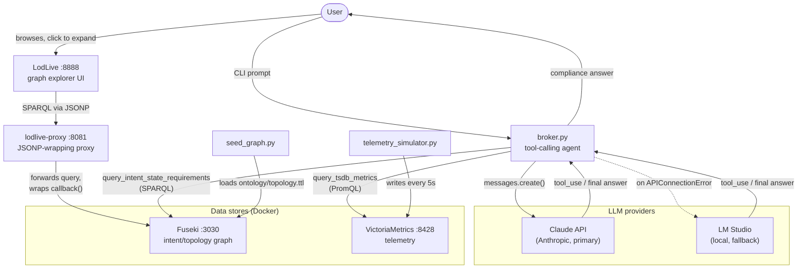

# Autonomous Context Broker

Compares live network telemetry (VictoriaMetrics) against declared intent
requirements (an OWL/RDFS graph in Apache Jena Fuseki), using Claude's
tool-calling loop (via the Anthropic SDK) to answer questions like
*"Is intent-core-health-01 compliant right now?"*

## Architecture



`broker.py` is the only component that talks to an LLM. It calls two tools —
`query_intent_state_requirements` (Fuseki) and `query_tsdb_metrics`
(VictoriaMetrics) — and hands their results to Claude to compare and answer.
`seed_graph.py` and `telemetry_simulator.py` are one-off/background setup
scripts that populate the two data stores; they never touch the LLM.

### `broker.py`

The tool-calling agent — the only script that talks to an LLM.

- **`query_intent_state_requirements(intent_id)`** — runs a SPARQL `SELECT`
  against Fuseki for a given intent (e.g. `intent-core-health-01`) and
  returns its declared target metric, operator, target value, and the
  `device`/`interface` pairs it applies to. Raises `ValueError` if the
  intent doesn't exist.
- **`query_tsdb_metrics(device, interface, metric_type, time_window)`** —
  runs a PromQL `max_over_time(...)` query against VictoriaMetrics for one
  interface and returns the observed value over that window, or `None` if
  there's no data.
- Both functions validate every argument against a strict allow-list regex
  (`_validate_token` / `_SAFE_WINDOW`) before it reaches the SPARQL/PromQL
  string, and reject any tool-call argument the tool's own JSON schema
  doesn't declare (`_execute_tool`) — this is what stops the LLM from
  injecting query syntax or redirecting a query to an attacker-controlled
  endpoint.
- **`run_agent(user_prompt)`** drives the tool-calling loop: it sends the
  prompt and `SYSTEM_PROMPT` to Claude (`_run_claude`), executes whatever
  tools Claude asks for via `_execute_tool`, feeds the results back, and
  repeats (up to `MAX_ITERATIONS`) until Claude returns a final text
  answer. If Claude's API is unreachable (`anthropic.APIConnectionError`),
  it restarts the whole conversation against a local LM Studio server
  instead (`_run_lmstudio`) — see [Optional: local LM Studio
  fallback](#optional-local-lm-studio-fallback).
- Run directly: `python broker.py "<question>"` (or with no argument, it
  prompts interactively).

### `seed_graph.py`

One-off setup script — loads the topology/intent ontology into Fuseki so
`broker.py` has something to query.

- **`load_ttl_to_fuseki(ttl_path, data_endpoint, auth)`** reads a Turtle
  (`.ttl`) file and `POST`s its raw bytes to Fuseki's Graph Store Protocol
  endpoint (`/network-dataset/data`) with HTTP basic auth (`admin`/`admin`
  by default — matches the `ADMIN_PASSWORD` in `docker-compose.yml`).
- Run directly: `python seed_graph.py` loads
  `ontology/topology.ttl` (the `intent-core-health-01` requirement) into
  the default endpoint. Both the file path and the endpoint can be
  overridden as positional CLI args if you want to load a different
  ontology or target a different dataset.

### `telemetry_simulator.py`

Background script — generates synthetic interface telemetry and writes it
to VictoriaMetrics, standing in for a real network monitoring feed.

- **`generate_metrics(rng, inject_drops)`** produces one sample of
  `in_octets`, `out_octets`, and `input_drops` for one interface.
  `input_drops` is always `0` unless `inject_drops=True`, in which case
  there's a ~5% chance per sample of a nonzero value (1–20) — this is what
  drives the compliant-vs-non-compliant demo.
- **`format_line_protocol(...)`** / **`build_payload(...)`** format one
  sample per router (`Router-A`/`GigabitEthernet0/0/0`,
  `Router-B`/`GigabitEthernet0/0/1`) as InfluxDB line protocol, all tagged
  under the `interface_metrics` measurement.
- **`post_metrics(write_endpoint, payload)`** `POST`s that payload to
  VictoriaMetrics's InfluxDB-compatible write endpoint (`/write`).
- **`run(...)`** loops forever, posting a fresh batch every
  `POST_INTERVAL_SECONDS` (5s), unless `--once` is passed.
- Run directly: `python telemetry_simulator.py` (continuous) or
  `python telemetry_simulator.py --once` (single batch, for manual
  verification). Add `--inject-drops` to exercise the non-compliant path.
  `MEASUREMENT_NAME` (`"interface_metrics"`) is imported by `broker.py` so
  the two scripts can never disagree on the metric name prefix.

### `lodlive-proxy/jsonp_proxy.py`

A small stdlib-only HTTP proxy that sits in front of Fuseki so the
[LodLive](http://lodlive.it/) graph explorer can query it — see
[Optional: explore the graph visually](#optional-explore-the-graph-visually-lodlive).

- LodLive's SPARQL requests go through jQuery's `jquery.jsonp` plugin, which
  loads results via a `<script src="...">` tag and expects the response
  body to be JavaScript invoking a callback function — not raw JSON. Fuseki
  only ever returns plain `application/sparql-results+json`, so without
  this proxy the browser silently fails to execute the response.
- **`JsonpProxyHandler.do_GET`** reads the `query` parameter off the
  incoming request, forwards it to Fuseki's query endpoint, and wraps the
  JSON response as `<callback>(<json>);`. The callback name isn't fixed —
  `lodlive.core.js` calls `$.jsonp.setup({callback: 'lodlive'})` globally,
  so real requests carry an explicit `callback=lodlive` parameter, which
  the proxy honors; it falls back to `jquery.jsonp`'s own undeclared
  default (`_jqjsp`) only if a request omits the parameter. The callback
  name is validated against a JS-identifier allow-list before being
  embedded in the response, since it's executed as code.
- Runs as its own container (see `docker-compose.yml`); not meant to be run
  standalone outside Docker.

## Prerequisites

- Docker and Docker Compose
- Python 3.11
- An Anthropic API key (console.anthropic.com)

## 1. Set up the Python environment

A venv already exists at `venv/`. If you need to recreate it:

```bash
python3 -m venv venv
source venv/bin/activate
pip install -r requirements.txt
```

Dev/test-only dependencies (`pytest`, `pyyaml`, `rdflib`) are not in
`requirements.txt` — install them separately if you want to run the tests:

```bash
pip install pytest pyyaml rdflib
```

## 2. Configure the LLM

Edit `.env` and replace the placeholders with real values:

```
ANTHROPIC_API_KEY=your-api-key-here
MODEL_NAME=claude-opus-5
```

`MODEL_NAME` is optional — it defaults to `claude-opus-5` if unset.

### Optional: local LM Studio fallback

If Claude's API is unreachable (e.g. no network), `broker.py` falls back to a
local model served by [LM Studio](https://lmstudio.ai/). Add to `.env`:

```
LMSTUDIO_BASE_URL=http://<lm-studio-host>:1234/v1
LMSTUDIO_MODEL=<model-name-as-shown-in-lm-studio>
```

`LMSTUDIO_BASE_URL` defaults to `http://localhost:1234/v1` if unset.
`LMSTUDIO_MODEL` has no default — the fallback raises a clear error if it's
unset when Claude is unreachable, rather than guessing a model name.

If you're running this inside a VM (e.g. Ubuntu on VMware Fusion on a Mac)
and LM Studio runs on the host:
1. In LM Studio, enable **Serve on Local Network** (it only binds to
   `127.0.0.1` by default, which the VM can't reach).
2. Set the VM's network adapter to **Bridged** rather than NAT, so it shares
   the host's LAN and can reach the host's LAN IP directly.
3. Set `LMSTUDIO_BASE_URL` to `http://<mac-lan-ip>:1234/v1`.

The fallback only triggers on connection/network errors (timeout, DNS
failure, connection refused) — authentication and rate-limit errors from
Claude's API still fail loudly rather than being silently masked.

## 3. Start the data stores

```bash
docker compose up -d
```

This starts:
- **VictoriaMetrics** on `localhost:8428` (telemetry storage)
- **Fuseki** on `localhost:3030`, dataset `network-dataset` (intent/topology graph).
  Both images are multi-arch (amd64/arm64), so this works on Apple Silicon and
  other ARM hosts without emulation. The Fuseki admin/query UI is browsable
  directly at `http://localhost:3030/`.

Fuseki's write endpoints (`/network-dataset/data`, `/network-dataset/update`)
require basic auth — username `admin`, password `admin` (set via
`ADMIN_PASSWORD` in `docker-compose.yml`). The query endpoint
(`/network-dataset/query`), used by `broker.py`, is unauthenticated.

## 4. Seed the ontology into Fuseki

```bash
source venv/bin/activate
python seed_graph.py
```

Loads `ontology/topology.ttl` — the `intent-core-health-01` requirement
(zero input drops) on the link between `Router-A`/`GigabitEthernet0/0/0`
and `Router-B`/`GigabitEthernet0/0/1`.

### Optional: explore the graph visually (LodLive)

`docker compose up -d` (step 3) also starts [LodLive](http://lodlive.it/), an
interactive click-to-expand RDF graph browser — similar in spirit to
Stardog's Explorer. Once the ontology is seeded, open:

```
http://localhost:8888/app_en.html
```

and click one of the pre-configured examples in the sidebar
(`intent-core-health-01`, the Router-A↔Router-B link, or the Router-A
interface) to start exploring. Clicking a node expands it to show its
connected neighbors.

Fuseki's SPARQL endpoint only returns plain JSON, but LodLive requires a
JSONP-wrapped response — `lodlive-proxy` (port 8081) sits between them to
translate, so LodLive is configured to query it rather than Fuseki
directly (see `lodlive/lodlive.profile.js` and
[`lodlive-proxy/jsonp_proxy.py`](#lodlive-proxyjsonp_proxypy)).

## 5. Start the telemetry simulator

Run once, to check it's working:

```bash
python telemetry_simulator.py --once
```

Run continuously in the background (writes to VictoriaMetrics every 5s):

```bash
nohup python telemetry_simulator.py > telemetry.log 2>&1 &
echo $! > telemetry.pid
```

Stop it later with `kill $(cat telemetry.pid)`.

By default the simulator emits zero `input_drops` (a compliant demo). Add
`--inject-drops` to randomly emit drops (~5% chance per sample) and see the
broker report a non-compliant result instead:

```bash
python telemetry_simulator.py --inject-drops
```

## 6. Ask the broker

```bash
python broker.py "Is intent-core-health-01 compliant right now?"
```

The broker reads the intent's requirement from Fuseki, reads the observed
metric from VictoriaMetrics, and has the LLM compare the two and answer.

## Running the tests

Tests mock all network calls (Fuseki/VictoriaMetrics/LLM) except one, which
runs a real SPARQL query against `ontology/topology.ttl` via `rdflib` — no
Docker required to run the suite:

```bash
pytest tests/ -v
```

## Shutting down

```bash
kill $(cat telemetry.pid)   # if running in the background
docker compose down
```
